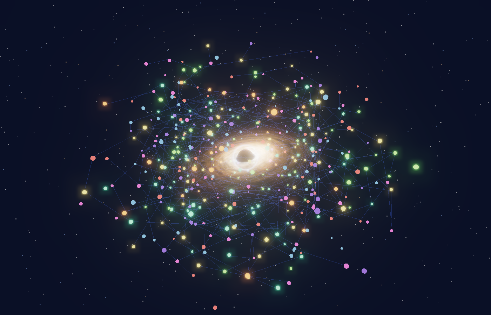
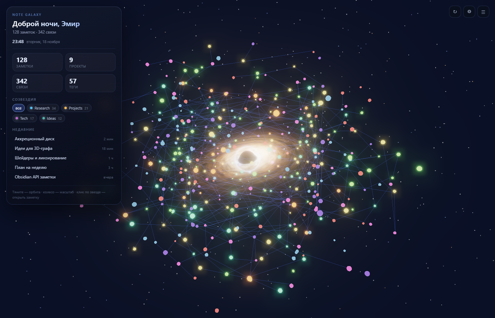

# Note Galaxy

[](LICENSE)

A 3D note graph for [Obsidian](https://obsidian.md). Notes become stars orbiting an
animated black hole, projects glow as golden cores, and a dashboard greets you with
the day's context.



## Features

- **3D graph** — force layout (spiral + springs + soft shell), notes slowly drift and bob.
- **Accretion disk** — GLSL shader with differential rotation, turbulent clumps,
  a temperature gradient and Doppler beaming on one side.
- **Bloom** — `UnrealBloomPass` for the disk, the photon ring and the stars.
- **Dashboard** — time-of-day greeting, clock, stats (notes / projects / links / tags),
  folder "constellations" with a filter, and recent notes.
- **Interaction** — hover highlights a star's links and title, click opens the note,
  scroll zooms, drag orbits.
- **Bilingual UI** — English and Russian out of the box, auto-detected from Obsidian.



## Install

### Manual

1. Download `main.js`, `manifest.json` and `styles.css` from the latest release.
2. Put them into `<vault>/.obsidian/plugins/note-galaxy/`.
3. Enable **Note Galaxy** in *Settings → Community plugins*.

### BRAT

Add the repository `remageht/note-galaxy` in the BRAT plugin and click **Add Plugin**.

## Usage

Open the graph with the orbit ribbon icon or run **Note Galaxy: Open 3D graph** from the
command palette. In the view: drag to orbit, scroll to zoom, click a star to open the note.

Notes are ranked by link degree, so the most connected ones make it into the scene.
A note counts as a *project* when it lives in a `project`/`projects`/`проект`/`проекты`
folder, has a `#project`/`#проект` tag, or `type: project` in frontmatter.

## Settings

| Setting | What it does |
| --- | --- |
| Language | Auto / English / Русский, applies without reload |
| Name for the greeting | `Good evening, …` |
| Dashboard | Show or hide the side panel |
| Note labels | Titles of the most connected notes in space |
| Glow (bloom) | Halo strength |
| Disk speed | Accretion disk animation speed |
| Star size | Scale of note dots |
| Galaxy rotation | Rotation speed of the note cloud |
| Maximum notes | How many nodes to render |

## Development

```bash
npm install
npm run dev     # watch build into main.js
npm run build   # type-check + production bundle
```

```
src/
  main.ts              plugin entry, commands, settings
  i18n.ts              English/Russian dictionaries
  view/GraphView.ts    ItemView: scene, camera, raycasting, labels
  scene/blackhole.ts   black hole, accretion disk, starfield
  scene/notes.ts       instanced note stars and links
  data/graph.ts        graph from metadataCache
  data/layout.ts       3D force layout
  ui/dashboard.ts      dashboard panel
```

A standalone scene preview lives in `preview/`:

```bash
npx esbuild preview/preview.ts --bundle --format=iife --outfile=preview/bundle.js
```

Then open `preview/index.html` in a browser.

## Adding a language

1. Copy the `en` object in `src/i18n.ts` and translate the strings.
2. Add the code to `LanguageCode`, `DICTS` and `LANGUAGES`.
3. Run `npm run build`. The settings dropdown picks the new language automatically.

## License

[MIT](LICENSE)
