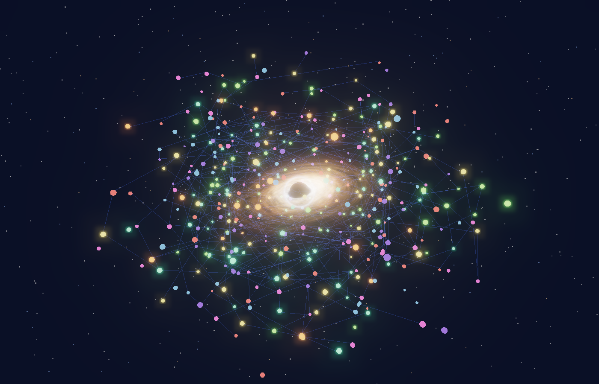
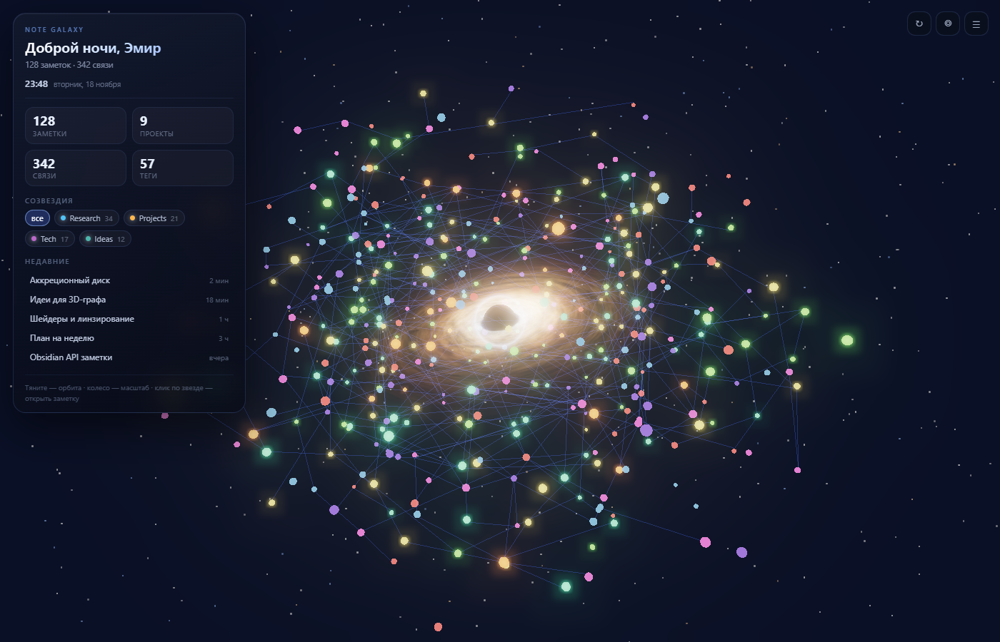

# Note Galaxy

[](LICENSE)

3D-граф заметок для [Obsidian](https://obsidian.md). Заметки становятся звёздами,
летящими вокруг анимированной чёрной дыры, проекты светятся золотыми ядрами,
а дашборд здоровается и показывает контекст дня.



## Возможности

- **3D-граф** — силовая раскладка (спираль + пружины + мягкая оболочка), заметки плавают и покачиваются.
- **Аккреционный диск** — GLSL-шейдер с дифференциальным вращением, турбулентными сгустками,
  температурным градиентом и доплеровским усилением одной стороны.
- **Свечение** — `UnrealBloomPass` для диска, фотонного кольца и звёзд.
- **Дашборд** — приветствие по времени суток, часы, статистика (заметки / проекты / связи / теги),
  «созвездия» папок с фильтром и недавние заметки.
- **Взаимодействие** — наведение подсвечивает связи и имя, клик открывает заметку,
  колесо — масштаб, перетаскивание — орбита.
- **Одиннадцать языков** — English, Русский, Українська, Deutsch, Español, Français, Italiano,
  Português (Brasil), Polski, 简体中文, 日本語. Определяется по языку Obsidian, переключается в настройках.



## Установка

### Вручную

1. Скачайте `main.js`, `manifest.json` и `styles.css` из последнего релиза.
2. Положите их в `<vault>/.obsidian/plugins/note-galaxy/`.
3. Включите **Note Galaxy** в *Настройки → Сторонние плагины*.

### BRAT

Добавьте репозиторий `remageht/note-galaxy` в плагине BRAT и нажмите **Add Plugin**.

## Использование

Откройте граф иконкой орбиты на ленте или командой **Note Galaxy: Открыть 3D-граф**.
В окне: тяните — орбита, колесо — масштаб, клик по звезде — открыть заметку.

Заметки ранжируются по количеству связей, поэтому в сцену попадают самые связанные.
Заметка считается *проектом*, если лежит в папке `project`/`projects`/`проект`/`проекты`,
имеет тег `#project`/`#проект` или `type: project` во frontmatter.

## Настройки

| Параметр | Что делает |
| --- | --- |
| Язык | Авто / English / Русский, применяется без перезапуска |
| Имя для приветствия | «Добрый вечер, …» |
| Дашборд | Показать или скрыть панель |
| Подписи заметок | Названия самых связанных заметок в космосе |
| Свечение (bloom) | Сила ореола |
| Скорость диска | Скорость анимации аккреционного диска |
| Размер звёзд | Масштаб точек-заметок |
| Скорость вращения галактики | Скорость вращения облака заметок |
| Максимум заметок | Сколько узлов рендерить |

## Разработка

```bash
npm install
npm run dev     # сборка в режиме наблюдения
npm run build   # проверка типов + production-бандл
```

```
src/
  main.ts              точка входа, команды, настройки
  i18n/                словари и определение локали
  view/GraphView.ts    ItemView: сцена, камера, лучи, подписи
  scene/blackhole.ts   чёрная дыра, аккреционный диск, звёздный фон
  scene/notes.ts       instanced-звёзды заметок и связи
  data/graph.ts        сборка графа из metadataCache
  data/layout.ts       3D-раскладка
  ui/dashboard.ts      панель-дашборд
```

Автономное превью сцены лежит в `preview/`:

```bash
npx esbuild preview/preview.ts --bundle --format=iife --outfile=preview/bundle.js
```

Затем откройте `preview/index.html` в браузере.

## Как добавить язык

1. Скопируйте `src/i18n/en.ts` в `src/i18n/<код>.ts` и переведите строки.
2. Добавьте код в `LanguageCode` в `src/i18n/types.ts`.
3. Импортируйте словарь и добавьте его в `DICTS` и `LANGUAGES` в `src/i18n/index.ts`.
4. Запустите `npm run build`. Выпадающий список в настройках подхватит язык сам.

## Благодарности

Сделано на [three.js](https://threejs.org) (MIT). Уведомление о лицензии
сохранено в конце `main.js`.

## Лицензия

[MIT](LICENSE)
